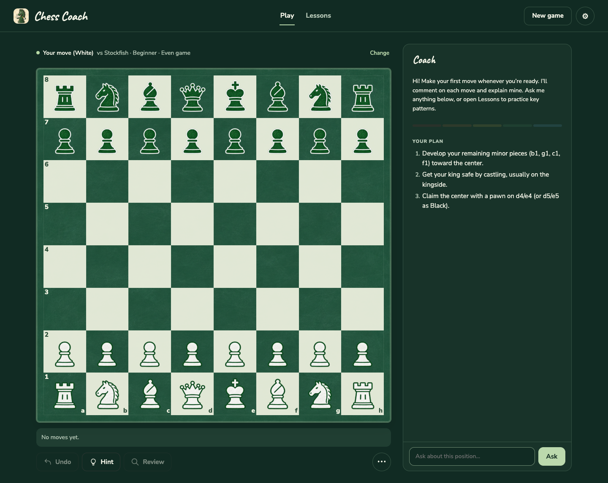

# Chess Coach



A responsive chess trainer with teaching games, a 24-lesson curriculum, objective Stockfish analysis, and optional AI-written coaching. It runs locally without an AI provider and automatically enables richer explanations when AkashML is configured.

## Run locally

Requires Node.js 22 or newer.

```sh
npm install
cp .env.example .env
npm start
```

Open <http://127.0.0.1:4173>.

For AkashML coaching, put your AkashML credential in `.env`:

```dotenv
LLM_API_KEY=<your AkashML credential>
LLM_PROVIDER=akashml
LLM_MODEL=Qwen/Qwen3.8-27B
LLM_MODEL_QUICK=Qwen/Qwen3.6-35B-A3B
LLM_MODEL_DEEP=zai-org/GLM-5.3
```

The credential stays on the server. The browser calls the same-origin `/api/coach` endpoint, and the server authenticates to AkashML's Anthropic-compatible Messages API. Stockfish—not Qwen—grades the student's move and chooses the coach's reply. Qwen turns that analysis into concise teaching feedback. If the key is absent or AkashML is unavailable, the app continues with deterministic local coaching.

Coach strength now changes actual engine behavior:

| Setting | Search | Move selection |
|---|---:|---|
| Beginner | depth 6, 12 candidates | May choose a candidate within 4.5 pawns of the best move |
| Improving | depth 12, 4 candidates | Usually favors the best candidates and stays within 0.85 pawns |
| Club | depth 15 | Always plays Stockfish's best move |

`POST /api/analyze` is the local analysis endpoint. It accepts the current FEN plus the optional pre-move FEN and student UCI move, then returns the selected coach move, engine grade, centipawn loss, and best student alternative.

Difficulty affects the coach's move selection, not the quality of student feedback. Student moves are
graded with a separate depth-12 search even when the Beginner opponent searches only to depth 6.

### Opponent engines

The game offers two move engines while retaining Stockfish for objective student grading:

| Engine | Purpose | Strength mapping |
|---|---|---|
| Stockfish 19 | Calculated engine play | Existing depth/candidate profiles above |
| Maia-3 5M | Human-like sampled play conditioned on rating | Beginner 800, Improving 1200, Club 1600 Elo |

Maia runs on CPU in the internal-only `maia` Compose sidecar. Its port is not published. The image
pins both the upstream source commit and model revision, embeds a SHA-256-verified checkpoint, and
caps the sidecar at one CPU and 1 GB RAM. The browser sends reconstructed UCI move history so Maia
can use its eight-position history. If Maia is unavailable, the Node server automatically uses the
already-computed Stockfish move and tells the player about the fallback.

Maia's human-outcome scores are not used for grading. Its upstream documentation explicitly
distinguishes those predictions from a searched engine evaluation, so Stockfish remains authoritative
for assessment labels, centipawn loss, and the suggested better move. See
[`THIRD_PARTY_NOTICES.md`](THIRD_PARTY_NOTICES.md) for source revisions and licensing.

After every coach move, the board stays locked for a 700 ms reveal: the piece visibly travels from its origin to its destination, the move squares receive a strong highlight, and a persistent `Coach played …` notice remains until the student moves.

## Interface and appearance

The play screen follows the v2 redesign: a larger board, a horizontal graded move list,
and one coach panel containing move feedback, the coach’s reply, your plan, and questions.
The current position stays first; past turns and earlier questions live under **Earlier coaching**.
The plan continues with follow-on goals after the opening principles have been completed.
Above 1400px, the board scales with both window dimensions so the move list, action buttons,
and pinned ask box fit without page scrolling; longer coaching content scrolls inside its panel.
On landscape iPads, the header and action buttons move into the coach panel to give the board
more room. On phones, the panel stacks below the board.

Lessons keep the current exercise and practice controls in the sidebar. **Choose lesson** opens
a separate, filterable lesson browser with one scrolling area; choosing an exercise returns to
the board. Hints and explanations appear below the exercise. In Board only layout,
**Lesson details** above the board reopens the lesson drawer; the floating button and
the active **Lessons** tab also reopen it.

Settings offers **Coach panel** and **Board only** layouts. Board only adds an on-board grade
and an **Ask the coach** button that opens a side sheet on desktop or a bottom sheet on phones.
Switching layouts keeps your game. The **⋯** menu provides Copy PGN and Resign, with an inline
confirmation before resignation.

Choose **Auto**, **Light**, or **Dark** appearance and one of six board-and-piece styles:
**Classic**, **Aether Court**, **Neon Orbit**, **Wildwood**, **Spell & Scale**, and **Chalkboard**. Each style
changes the app’s colors and fonts; only the active style’s fonts load. Illustrated boards
fall back to Classic if artwork is unavailable. Layout, style, and appearance are saved locally
under `chesscoach.layout`, `chesscoach.boardStyle`, and `chesscoach.theme`.

Chalkboard is the default for new users; an existing saved style choice is preserved.
It pairs a textured green slate board with warm white squares and illustrated white/green
chalk pieces. It includes matching light/dark colors and handwritten headings. The generated
artwork and prompt record are documented in [`docs/chalkboard-artwork.json`](docs/chalkboard-artwork.json).

Appearance and layout apply immediately. Options under **Next game**—color, strength, opponent,
coaching depth, and handicap—are kept when you close settings with **Done**, and apply when you press **New game** in the header.
The header button starts the game immediately. Engine and coaching
availability appear under **About** in settings.

Coach modes split work by purpose:

| Mode | Normal moves | Hints | Questions and game review |
|---|---|---|---|
| Fast | Qwen 3.6 A3B | Qwen 3.6 A3B | Qwen 3.6 A3B |
| Thorough | Qwen 3.8 | Qwen 3.8 | Qwen 3.8 |
| Deep review | Qwen 3.8 | Qwen 3.8 | GLM 5.3 |

Deep Review deliberately keeps ordinary moves on Qwen 3.8 because Stockfish already supplies the chess calculation and GLM can take 20–30 seconds while reasoning. GLM requests receive a 1,800-token budget and 60-second timeout. Confirm configured model aliases against AkashML's current model catalog before deployment.

## Commands

```sh
npm test       # lesson, handicap, Stockfish, and mocked AkashML proxy tests
npm run test:ui # Chrome browser checks for layouts, settings, themes, and game interactions
npm run build  # standalone app plus self-contained Artifact source in dist/
npm start      # build and serve locally
```

The UI checks use an installed Google Chrome. To use Playwright’s Chromium instead, run
`npx playwright install chromium` followed by `PLAYWRIGHT_BROWSER=chromium npm run test:ui`.

The server binds to `127.0.0.1` by default. Keep it behind a trusted LAN, VPN, or authenticated
reverse proxy. Do not expose it directly to the public internet: `/api/coach` uses the server's API
allowance and the app does not include user authentication or request-rate controls.

## Add to Home Screen

The standalone build includes a PWA manifest plus Apple home-screen metadata. On an iPad or iPhone,
open either HTTPS address in Safari, use **Share → Add to Home Screen**, and Chess Coach installs with
the green “Coach Knight” mascot. The source artwork and generated 180, 192, and 512 px icons live in
`src/icons/`; `npm run build` copies the production sizes and `src/manifest.webmanifest` into `dist/`.
If an older shortcut already exists, remove it and add it again because iPadOS caches home-screen icons.

## Docker and Proxmox deployment

The container is stateless: lesson progress and the current game remain in each browser's local storage. No host data volume is required. The image runs as UID/GID `10001`, uses a read-only filesystem, drops all Linux capabilities, and includes an HTTP health check.

On the Proxmox app container or VM:

```sh
sudo install -d -m 750 /opt/apps/chess-coach
cd /opt/apps/chess-coach
# Copy this project here, then:
cp .env.example .env
chmod 600 .env
```

Set `LLM_API_KEY` in `.env`, verify that host port `9123` is unused, and start it:

```sh
docker compose config --services
docker compose up --build -d
docker compose ps
curl --fail http://127.0.0.1:9123/api/health
```

Compose binds to `127.0.0.1:9123` and a configurable second private address (`CHESS_COACH_LAN_BIND`, default `127.0.0.2`). Publish that loopback service with a new, unused Tailscale Serve HTTPS port, preserving the server's existing Serve configuration. Do not use Funnel: this app has no user authentication and is intended to remain Tailnet-only.

To update it later:

```sh
# Preserve the current image for rollback before rebuilding
docker tag chess-coach:local chess-coach:previous
docker compose build chess-coach
docker compose up -d --no-deps chess-coach
curl --fail http://127.0.0.1:9123/api/health
```

For frontend-only updates, this leaves the Maia sidecar running. Preserve the server’s `.env`
and a source backup, and retain the previous image until verification is complete.

Before every deployment, recheck the host and proxy ports rather than assuming the example values
are free. `deploy/traefik/chess-coach.yml` is a template: replace its example hostname, certificate
resolver, and private backend address for your network.

## API-key safety

- `.env` and common credential-file formats are ignored by Git; `.env.example` contains no value.
- `LLM_API_KEY` is read only by the Node server and is never embedded in `dist/` or returned by
  `/api/health`.
- Browser requests use same-origin `/api/coach`; the server adds the upstream authorization header.
- Anyone who can administer the Docker host can inspect container environment variables. Restrict
  host access and file permissions, rotate exposed credentials immediately, and never commit `.env`.
- Before publishing a fork, inspect staged files with `git diff --cached` and run a secret scanner.

## License

Released under the [MIT License](LICENSE). Third-party engine and model components retain their own
licenses; see [`THIRD_PARTY_NOTICES.md`](THIRD_PARTY_NOTICES.md).
